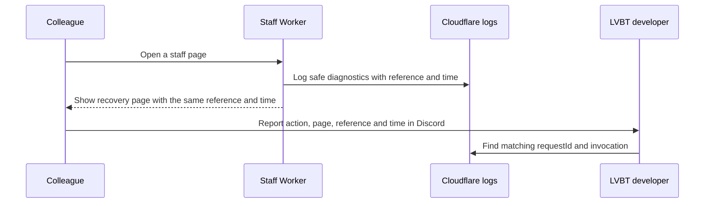

# Investigate a staff failure

LVBT developers use this guide to turn a colleague's outage report into a diagnosis and verify a
repair. Start here when someone posts a reference from the staff recovery page in Discord.

## Before you start

You need access to the LVBT Cloudflare account's Worker logs and the source or saved build for the
affected release. A Worker is the application Cloudflare runs for each request. Production uses
`lvbt-staff`; the protected preview uses `lvbt-staff-preview`.

Confirm that the affected release includes reference logging. A source change alone does not change
production. This guide does not authorize a deployment, database change or billing change.

## Find the failure

1. Collect the reference, displayed time, page and attempted action. Ask colleagues to omit member
   details, credentials and screenshots of member records from Discord reports.
2. Open the LVBT account in Cloudflare. Select **Workers & Pages**, the affected Worker and
   **Observability**. These are Cloudflare's
   [documented log navigation steps](https://developers.cloudflare.com/workers/observability/logs/workers-logs/#view-logs-from-the-dashboard).
3. Select a time range around the report. The page shows Pacific time; `occurredAt` records UTC
   (Coordinated Universal Time). Search for the complete reference, including its hyphens. Find the
   structured `staff_request_failed` entry whose `requestId` matches it. This application reference
   is separate from Cloudflare's own request identifiers.
4. Open the matching invocation. Record its deployed version and inspect the fields below. Keep
   detailed evidence in a private incident record before logs expire.

This made-up example shows an error caught by the gateway, the code that handles incoming requests:

```json
{
  "event": "staff_request_failed",
  "layer": "gateway",
  "category": "unexpected",
  "diagnostics": {
    "errorType": "Error",
    "causeCode": "missing_table",
    "frames": ["worker.mjs:120:8"]
  },
  "requestId": "ABCD-1234-5678",
  "occurredAt": "2026-10-20T06:45:57.496Z"
}
```

The following table maps the diagnostic values to the next investigation step.

| Field or value                                  | Meaning and next step                                                                                                                                                                                                          |
| ----------------------------------------------- | ------------------------------------------------------------------------------------------------------------------------------------------------------------------------------------------------------------------------------ |
| `layer: gateway` or `middleware`                | The application caught an exception at that boundary. Inspect `diagnostics` and the matching invocation.                                                                                                                       |
| `layer: response`                               | The application generated an HTTP server-error response without a captured exception. Inspect `status` and invocation context; this entry has no `diagnostics`.                                                                |
| `database_read_limit` or `database_write_limit` | Cloudflare D1, the database service, rejected work at the account's daily row allowance. Follow [capacity recovery](../reference/staff-availability.md#remove-the-recurring-capacity-failure). Stop repeated database retries. |
| `missing_table` or `missing_column`             | Compare the active release, bound database and applied migrations through [staff operations](../reference/staff-portal-operations.md). Do not run an ad hoc schema change.                                                     |
| `unclassified`                                  | The classifier did not recognize the cause. Use the safe error type, code locations and local reproduction. This value does not rule out a database failure.                                                                   |
| `diagnostics.frames`                            | Up to six unique file basenames with line and column numbers. Match them against the exact saved build; compiled locations can differ from source locations. An empty list means no supported location was extracted.          |

`category` groups failures as `database_read_limit`, `database_write_limit` or `unexpected` for
captured exceptions. `causeCode` provides the more specific classification. `errorType` contains an
allowed built-in error name or `unknown`; it does not contain the exception message.

## Understand the reporting boundary

This sequence diagram shows the reporting flow. The Worker creates the reference and timestamp
without querying the database. It keeps them when middleware or gateway recovery replaces an error
response with the branded page.



The response also carries `X-LVBT-Error-Reference` and `X-LVBT-Error-Time` headers. A reference
identifies a failed response, not an ongoing incident or proof that a write failed. After a failed
submission, check the saved record before repeating the action.

The custom diagnostic entry excludes raw exception messages, SQL statements, member data, call
arguments and full filesystem paths. Developers must preserve this boundary when adding diagnostic
fields. Other platform logs can contain request metadata; treat the entire invocation as private.
The recovery page requires no JavaScript or external asset request. Discord opens the organization's
server; the page does not send a report automatically.

## Handle missing evidence

If no entry matches, check the Worker, time range and deployed version first. Inspect log
collection, sampling and account log limits next. Cloudflare currently documents three days of
retention and 200,000 daily log events on Workers Free. Recheck the
[provider limits](https://developers.cloudflare.com/workers/observability/logs/workers-logs/#pricing)
when investigating because Cloudflare has announced a pricing change for December 1, 2026.

Expired or uncollected logs cannot be reconstructed from the reference. Failures before the Worker
runs can have no reference. Preserve the reported time, affected page and deployment version in the
private incident record. Investigate Access, routing and platform errors when no Worker invocation
exists. Do not tell a colleague that no failure occurred because a search returned no match.

## Verify a repair

Run `pnpm check` from the repository root. For changes to recovery handling, also run these focused
checks after installing dependencies through the [local setup guide](../tutorials/start-here.md):

```sh
pnpm -C apps/staff exec node --import tsx --test tests/responses.test.ts
pnpm -C apps/staff build
pnpm -C apps/staff exec node --import tsx tests/e2e/recovery.spec.ts
```

The tests check reference continuity, private diagnostics and a simulated database failure through
the compiled Worker. They do not prove that production collects the logs or that the live service is
available. Never break a live table to reproduce the fixture. Review the recovery page on desktop
and phone when changing its copy or layout. After an authorized release, verify sign-in and member
search in the affected environment. Follow the
[availability reference](../reference/staff-availability.md#verify-a-recovery) for the remaining
recovery evidence and the 30-day availability target.
