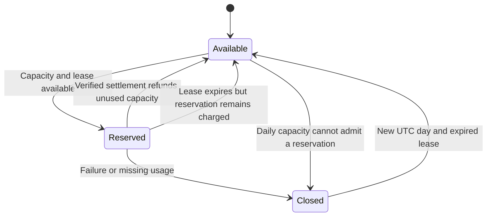

# Staff availability

Maintainers use this reference to measure staff access, investigate failures and verify recovery.
The target is **99.9% availability over a rolling 30 days**. This allows 43 minutes and 12 seconds
of unavailability. This target is an operational SLO; it does not establish a contractual SLA or
prove that production already meets it.

## Measure the task people need

Measure whether an authorized person can sign in, open Members and search for a member. A successful
Cloudflare Access redirect or a rendered recovery page does not establish availability. Count server
errors, timeouts and failed database-dependent reads as unavailable. Exclude deliberate refusals for
unauthorized accounts. Check mutations separately with an approved synthetic account and reversible
fixtures; never create real membership or consent changes just to monitor uptime.

Use an external probe every 60 seconds through the normal protected sign-in path. Alert the
responsible maintainer after two consecutive failed checks. Retain probe outcomes and Worker error
counts for the same 30-day window. Include failures before requests reach the Worker. Keep probe
credentials private and preserve Access, session and staff authorization checks.

External authenticated probes and alerts require a configured identity, scheduler and recipient. The
application changes do not provision those services. Until maintainers verify that setup and collect
results, report availability as unmeasured. Worker logs alone omit edge and sign-in failures.

## Remove the recurring capacity failure

Cloudflare D1 Free limits the whole account to 5 million rows read and 100,000 rows written per day.
Production, previews and operator work share that limit. The allowance resets at 00:00 UTC.
Cloudflare rejects database work once the allowance runs out. A styled recovery page cannot restore
staff access. See [D1 pricing](https://developers.cloudflare.com/d1/platform/pricing/).

Keep the existing Free plan. Bound scheduled work, check account-wide usage and reserve capacity for
staff and member requests. Defer imports and other bulk work when capacity is low. Apply the missing
indexes and verify the matching active release before attributing continued usage to normal demand.
A reliability request does not authorize a plan change. If verified demand cannot fit the allowance,
maintainers must choose a capacity change explicitly. Neither a plan nor local query tests establish
the availability target.

Keep the observation-history index, erasure audit index and bounded provider selection migrations
with the matching jobs release. Retain ownership, consent, generation and erasure checks. Test real
D1 read costs with long histories and blocked queues before changing these paths. A returned-row
limit or statement budget does not bound the rows SQLite scans.

## Reserve database capacity for people

Migration **0051** adds a persistent budget for the scheduled jobs in each canonical database.
Production jobs admit reservations within an allocation of 2,000,000 reads and 40,000 writes per UTC
day. Preview jobs use 250,000 reads and 5,000 writes. Together those allocations leave 55% of the
Free account allowance outside these scheduled jobs. Staff/member requests, imports, backups and
other databases are not counted by this ledger and can still exhaust that remaining allowance.

Each cron invocation reserves 50,000 reads and 4,000 writes atomically before starting its jobs. A
120-second lease prevents overlapping parent runs. Jobs return actual D1 row counters. Successful
settlement refunds unused capacity and charges the guard plus a conservative allowance for its own
settlement. A crash keeps its reservation. Admission requires room for the full reservation, so work
can stop with fewer than 50,000 reads or 4,000 writes left in its allocation. A stale run cannot
refund a newer lease or another UTC day. One bounded database statement can exceed a reservation
before D1 reports its cost; an overrun charges the measured amount and closes background work for
the day.

Missing job telemetry, database errors and unverified RPC results close background work through the
UTC reset. Settlement keeps the full reservation and admission closed while verifying its first
write. Only verified accounting permits the final refund and release. If the final release commits
but its acknowledgment is lost, its outcome is uncertain; verified work and both control writes
remain charged. Inspect the ledger before manual recovery. A denied guard performs no provider
calls. If D1 cannot accept even the guard or settlement, subsequent ticks attempt only the singleton
guard before returning. This cannot establish an account-wide cooldown when the database refuses to
store state.

The following state machine describes the persisted budget. An outstanding lease must expire before
a new day can admit another run.

Budget deferral can delay scheduled reconciliation and retention work. Admitted runs process
incoming choices, provider scans and saved poll choices before outgoing account changes. Existing
consent, ownership and provider leases still apply. Direct staff/member requests do not enter this
scheduled-work budget. Do not promise immediate background revocations after the budget closes.

Records cleanup runs on the hourly tick, rather than every minute. It removes expired claims, stale
snapshots and records past their retention period in bounded batches. Reads must reject expired
credentials and snapshots independently of that cleanup. Profile erasure, incoming choices and
provider queues retain their minute cadence. A records backlog can require several hourly batches;
inspect its age before increasing throughput within the daily allocation.

Monitor `scheduled_work_deferred`, `scheduled_budget_guard` and `scheduled_budget_settled` alongside
account-wide D1 usage. On deferral, inspect the selected database's singleton budget, actual row
usage, queued work and active release. Preserve the row and diagnose the cause; do not delete or
reset it to force another run. The next UTC day can admit work again after the lease expires. A
same-day code rollback must retain this additive table and its privacy-independent accounting.

## Verify a recovery

Follow
[staff operations](staff-portal-operations.md#keep-background-work-within-the-shared-database-allowance)
for account usage, backups, canonical migrations and the protected release flow. Preserve the
selected release and existing deployment receipts. Stop manual retry loops during exhaustion.

After release, verify real authorized sign-in, member search and provider processing. Inspect
`job_database_usage` records across scheduled ticks and compare them with account-wide D1 usage over
a full day. Confirm that unknown metadata is not reported as zero usage. Confirm that a quota error
stops the remaining steps and that the next cron invocation does not resume expensive work after a
persisted closure. If D1 rejected settlement, distinguish a cheap failed guard from a stored
closure.

Record the deployed version, migration verification and aggregate availability privately. Keep
member data and credentials out of public incident notes. If production checks fail, follow the
saved-release recovery procedure and preserve evidence before making another publication attempt.
