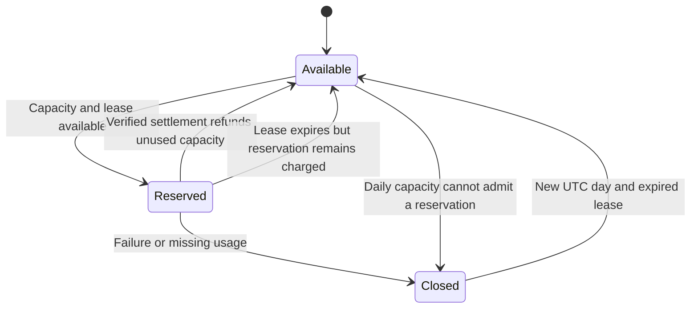
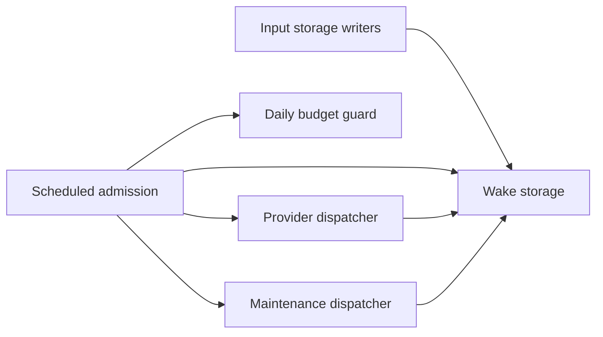

# Staff availability

Maintainers use this reference to measure staff access, investigate failures and verify recovery.
The target is **99.9% availability over a rolling 30 days**. This allows 43 minutes and 12 seconds
of unavailability. This service-level objective (SLO) is the team's operating target. It is not a
contractual service-level agreement (SLA), and it does not prove that production already meets the
target.

## Measure the task people need

Measure whether an authorized person can sign in, open Members and search for a member. A successful
Cloudflare Access redirect or a rendered recovery page does not establish availability. Count server
errors, timeouts and failed database-dependent reads as unavailable. Exclude deliberate refusals for
unauthorized accounts. Check mutations separately with an approved synthetic account and reversible
fixtures; never create real membership or consent changes just to monitor uptime.

Use an external probe every 60 seconds through the normal protected sign-in path. Alert the
responsible maintainer after two consecutive failed checks. Retain probe outcomes and Worker error
counts for the same 30-day window. Include failures before requests reach the Worker. Keep probe
credentials private and preserve Access, session and staff authorization checks.

External authenticated probes and alerts require a configured identity, scheduler and recipient. The
application changes do not provision those services. Until maintainers verify that setup and collect
results, report availability as unmeasured. Worker logs alone omit edge and sign-in failures.

## Investigate a reported failure

Follow [Investigate a staff failure](../guides/investigate-staff-failures.md) for log access, field
definitions, missing-evidence handling and local verification commands.

When a colleague flags an outage in Discord, find the displayed reference in the staff Worker's
`staff_request_failed` log entry under `requestId`. Use `occurredAt` to match the Pacific time shown
on the page. Ask which page failed and what the person was trying to do. The response keeps the same
reference through middleware and gateway recovery, so the reported reference identifies the logged
failure. Inspect `diagnostics.causeCode` for a known cause such as `missing_table`,
`diagnostics.errorType` for a safe error type, and `diagnostics.frames` for bounded code locations.
Locations omit full filesystem paths, exception messages and call arguments. Framework responses
without a captured exception retain the HTTP status and platform invocation context instead.
Creating the failure reference uses no database queries, and the page excludes exception contents
and member data. A failure before the request reaches the Worker may have no reference.

Investigate reports promptly. Cloudflare currently retains Workers Free logs for
[three days](https://developers.cloudflare.com/workers/observability/logs/workers-logs/#pricing).
The reference is a log lookup key, and it does not create a durable incident record. The Free log
retention does not satisfy the 30-day availability-record target above.

## Remove the recurring capacity failure

Cloudflare D1 Free limits the whole account to 5 million rows read and 100,000 rows written per day.
Production, previews and operator work share that limit. The allowance resets at 00:00 UTC.
Cloudflare rejects database work once the allowance runs out. A styled recovery page cannot restore
staff access. See [D1 pricing](https://developers.cloudflare.com/d1/platform/pricing/).

Keep the existing Free plan. Bound scheduled work, check account-wide usage and reserve capacity for
staff and member requests. Defer imports and other bulk work when capacity is low. Apply the missing
indexes and verify the matching active release before attributing continued usage to normal demand.
A reliability request does not authorize a plan change. If verified demand cannot fit the allowance,
maintainers must choose a capacity change explicitly. Neither a plan nor local query tests establish
the availability target.

Keep the observation-history index, erasure audit index and bounded provider selection migrations
with the matching jobs release. Retain checks for account ownership, consent, the latest operation
revision and erasure. Test real D1 read costs with long histories and blocked queues before changing
these paths. A returned-row limit or statement budget does not bound the rows SQLite scans.

## Reserve database capacity for people

Migration **0051** adds a persistent budget for the scheduled jobs in each environment's membership
database. Production jobs admit reservations within an allocation of 2,000,000 reads and 40,000
writes per UTC day. Preview jobs use 250,000 reads and 5,000 writes. Together those allocations
leave 55% of the Free account allowance outside these scheduled jobs. Staff/member requests,
imports, backups and other databases are not counted by this ledger and can still exhaust that
remaining allowance.

Each admitted cron invocation reserves 50,000 reads and 4,000 writes atomically before starting its
jobs. A 120-second lease prevents overlapping parent runs. Jobs return actual D1 row counters.
Successful settlement refunds unused capacity and charges the guard plus a conservative allowance
for its own settlement. A crash keeps its reservation. Admission requires room for the full
reservation, so work can stop with fewer than 50,000 reads or 4,000 writes left in its allocation. A
large initial roster can therefore defer later provider cleanup until the next UTC budget day; this
guard protects interactive capacity but does not guarantee immediate provider cleanup. A stale run
cannot refund a newer lease or another UTC day. One bounded database statement can exceed a
reservation before D1 reports its cost; an overrun charges the measured amount and closes background
work for the day.

Missing job telemetry, database errors and unverified RPC results close background work through the
UTC reset. Settlement keeps the full reservation and admission closed while verifying its first
write. Only verified accounting permits the final refund and release. If the final release commits
but its acknowledgment is lost, its outcome is uncertain; verified work and both control writes
remain charged. Inspect the ledger before manual recovery. A denied guard performs no provider
calls. If D1 cannot accept even the guard or settlement, subsequent ticks attempt only the due-work
read and, when work is due, the singleton guard before returning. This cannot establish an
account-wide cooldown when the database refuses to store state.

The following state machine describes the persisted budget. An outstanding lease must expire before
a new day can admit another run.



Budget deferral can delay scheduled reconciliation and retention work. Admitted runs process
incoming choices, provider scans and saved poll choices before outgoing account changes. Existing
consent, ownership and provider leases still apply. Direct staff/member requests do not enter this
scheduled-work budget. Do not promise immediate background revocations after the budget closes.

Migration **0053** adds four persisted wake signals for providers, profile cleanup, daily inactivity
cleanup and records cleanup. Quiet minutes execute one measured statement, invoke no child jobs and
write nothing. Input triggers wake work in the same transaction as the accepted change. A revision
number prevents a running job from clearing a newer signal. Job progress can retain one follow-up
drain; unchanged checkpoints do not wake work. Provider readiness checks skip completed commands,
future scans, empty queues and active provider backoffs before invoking child jobs.

Provider processing retains this order: incoming newsletter events, source scans, saved poll
choices, outgoing accounts and shared completion. Scans retain their existing hourly Discord and
fifteen-minute Beehiiv schedules. Future events, retries, held leases and receipt freshness retain
deadlines. An idle provider pass sets a fifteen-minute reconciliation deadline for blocked or
historical work. A full candidate page continues its bounded sweep within the invocation allowance
or on the next minute. Each lane records its sweep start and logical page end across wraparound. A
selected-row limit must never replace that continuation signal.

Profile erasure runs when deletion or merge eligibility changes. Physical purge retains the
thirty-day delay. Daily inactivity cleanup starts at 03:00 Pacific and resumes unfinished batches. A
completed day sleeps until the next Pacific window, including daylight-saving changes. Records
cleanup begins on the UTC hour and continues remaining batches on subsequent minutes. The backlog
check includes Google snapshots, Google check failures and unassigned roster evidence. Reads still
reject expired credentials and snapshots independently of cleanup.

A wake signal is a saved instruction to check a category of background work. The following component
diagram shows which modules save and consume those signals. Storage writers update the wake store
inside their existing transactions. Admission reads the wake store before reserving capacity. The
provider and maintenance dispatchers acknowledge only the revision they captured.



The daily ledger includes measured child work and control statements for admitted passes. Quiet
probes run outside its reservation. The due table contains four rows, so those probes add a small
fixed daily read cost. This ledger still cannot bound other databases or interactive requests.

Monitor `scheduled_work_deferred`, `scheduled_budget_guard` and `scheduled_budget_settled` alongside
account-wide D1 usage. On deferral, inspect the selected database's singleton budget, actual row
usage, queued work and active release. Preserve the row and diagnose the cause; do not delete or
reset it to force another run. The next UTC day can admit work again after the lease expires. A
same-day code rollback must retain this additive table and its privacy-independent accounting.

## Query-cost regression checks

The real local D1 fixtures cover growing observation history, blocked provider queues and idle
maintenance. Run the checks without production credentials:

```sh
pnpm -C apps/jobs exec node --import tsx --test --test-concurrency=1 tests/access-observation-read-budget.test.ts tests/profile-maintenance-read-budget.test.ts tests/provider-selection-read-budget.test.ts tests/scheduled-budget-d1.test.ts tests/scheduled-wake-d1.test.ts
```

The complete idle-hour fixture runs actual storage and provider-processing functions against local
D1 with synthetic data. It includes both providers, scheduled scans, hourly cleanup, control queries
and guard settlement. It enforces ceilings of **200 statements, 1,100 rows read and 100 rows
written** for that hour after initialization. Every quiet minute must execute exactly one statement
with zero writes and zero child calls. The fixture also checks that active backoffs leave
checkpoints untouched. Completed operations do not wake the scheduler when their historical receipts
expire. These are fixture budgets, not a production traffic cap.

The 2026-10-20 fixture used 100,000 synthetic profiles, 100,000 held newsletter jobs and 10,000
future inbound events plus 60 completed operations with staggered receipt deadlines. It measured
**194 statements, 992 rows read and 84 rows written** after initialization. The complete hour
includes 52 quiet ticks and eight admitted passes, including retained wakes after scan progress. The
statement breakdown is:

| Work                                   | Statements per fixture hour |
| -------------------------------------- | --------------------------: |
| Quiet-minute probes                    |                          52 |
| Due probes for admitted passes         |                           8 |
| Budget admission and settlement        |                          24 |
| Provider readiness reads               |                          24 |
| Future provider deadline reads         |                          16 |
| Provider wake acknowledgments          |                           8 |
| Record backlog read and acknowledgment |                           2 |
| Four Beehiiv roster scans              |                          36 |
| One Discord drift and roster scan      |                          15 |
| One records cleanup batch              |                           9 |
| **Total**                              |                     **194** |

This excludes fixture seeding, initialization and assertions that inspect database state. Those
operations do not run in production cron handlers. Real changes, backlog drains, provider retries
and daily privacy work add costs. The earlier 1,389-statements/hour calculation described an idle
minute-polling baseline rather than a measured live hour.

Discord drift selection starts from indexed Discord identities. It must not scan unrelated people.
Newsletter selection uses indexed effective due times that include held job leases. Each state
contributes a bounded candidate page before the final ordering. Future inbound events use the same
parsed date comparison as source processing. Do not replace these checks with small empty-table
fixtures or returned-row counts.

Migration **0052** indexes the exact parsed creation-date expression in inactive-profile selection.
In a synthetic fixture with 10,000 recent profiles, the first daily inactive pass fell from 30,431
reads to 433 reads. The test requires fewer than 1,000 reads for each measured selector or
maintenance pass and also checks a newly queued removal. Keep consent, identity and
recent-engagement exclusions unchanged. Do not substitute string date comparisons for parsed dates.

These measurements describe local fixtures. Compare deployed row counters after applying the
reviewed database migrations and activating the matching saved release. Creating the index also
consumes allowance; follow the backup and migration procedure before applying it. Retain the
additive index during a code rollback; it does not change retention eligibility.

## Verify a recovery

Follow
[staff operations](staff-background-work.md#keep-background-work-within-the-shared-database-allowance)
for account usage, backups, reviewed database migrations and the protected release flow. Preserve
the selected release and existing deployment receipts. Stop manual retry loops during exhaustion.

After release, verify real authorized sign-in, member search and provider processing. Inspect
`job_database_usage` records across scheduled ticks and compare them with account-wide D1 usage over
a full day. Confirm that unknown metadata is not reported as zero usage. Confirm that a quota error
stops the remaining steps and that the next cron invocation does not resume expensive work after a
persisted closure. If D1 rejected settlement, distinguish a cheap failed guard from a stored
closure.

Record the deployed version, migration verification and aggregate availability privately. Keep
member data and credentials out of public incident notes. If production checks fail, follow the
saved-release recovery procedure and preserve evidence before making another publication attempt.
